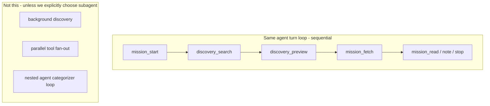

# FABLE 5 — Rubberduck: discovery loop, time budget, categorizer vs subagent

**For:** expensive-model session (operator logs into the good-token account).  
**Repo:** `~/dev/dsh-web-discovery` · sibling `~/dev/dsh-web-missions`  
**Related:** [`P0.5.md`](./P0.5.md) (implementation board) · [`HANDOVER.md`](./HANDOVER.md) (cold context)  
**Written:** 2026-10-16  
**Ask of you (Fable):** produce a **damn good plan** — recommend one architecture, name the traps, and say what *not* to build. Do not implement; decide.

Sacred ports: never kill `:3080` / `:8080`. Dogfood web: `:3090` only.

---

## The big constraint (put this on the whiteboard)

> **Discovery is not a parallel sidecar process.**  
> It rides the **same agent turn loop** as web-missions: **one tool call at a time, sequential.**

There is no background discovery worker, no fan-out of agent turns, no nested “go research while I think.” Every `discovery_*` call:

1. costs **one agent step** (tool → model observes → next tool),
2. dumps its receipt into **context** (token tax),
3. burns **wall clock** while the human/agent waits (especially browser39).

Missions already owns fetch budget, allowlist, depth fence, and the answer (`mission.md`). Discovery’s only job is a **thin opener**: better URLs in, less invented SERP junk — then get out of the way.

If the design needs parallelism, a second model loop, or a long-running categorizer pipeline, that is **already subagent territory**. Name it honestly or refuse it for v0.



---

## Product facts (ground truth)

| Fact | Detail |
| --- | --- |
| Package | `dsh-web-discovery@1.0.0` on npm; companion to `dsh-web-missions@1.0.0` |
| Today’s tools | One verb: `discovery_search` → candidates → optional `discovery.json` (missions reads only) |
| Engines (planned P0.5) | **browser39** (default #1, slow) → **SearXNG** (fast HTTP) → **YaCy** (fast HTTP, prove N-engine pattern) |
| ISO / local-first | No cloud LLM in the search loop today; allowlist still gates `mission_fetch` |
| Eris scar | No DIY DDG HTML scrape |
| Live wire | Not done — profile still old `dsh-local-web-discovery` symlink |
| Operator intent | Always include discovery with missions eventually; own both packages |

P0.5 draft verbs: `discovery_search` → `discovery_preview` → `discovery_scan` (depth-capped). Caps proposed: search limit 5, maxPreview 2, maxSearchTurns 1, compact previewChars, scan rare.

---

## The question to rubberduck

**How much time (and how many steps / tokens) can we afford for discovery before the mission must move toward the final answer — and what architecture gets keep/skip quality without becoming a subagent?**

Three levers people reach for:

### A — Aggregate / rank links differently (no new model)

- Snippet-first triage from SERP (title/snippet/host heuristics).
- Batch compact receipts in **one** tool call (`preview({ urls })` sequential inside the tool).
- Hard caps: `limit`, `maxPreviewPerSearch`, `maxDiscoveryMs`, scan off by default.
- Prefer **SearXNG when up** for wall-clock; browser39 as pin/fallback (tension with “browser39 #1”).

**Pros:** stays in same loop; deterministic; hermetic testable; no RAM/GPU fight with the main model.  
**Cons:** dumb heuristics; false skip/keep; operator still tunes denylists.

### B — Small local categorizer (1–2B, “JEV-like but open”)

Operator RAM gut-feel: can afford **~1–2B** open model as a **keep/skip / category** head over title+snippet(+short preview).

**Pros:** better semantic “worth diving?” than regex; still local/ISO-ish; could collapse many previews into one classify call.  
**Cons / traps:**

- Is the classify call a **tool** (same loop, +1 step + load latency) or a **hidden side inference** (sidecar → smells like subagent / second policy)?
- Cold start + VRAM fight with the main harness model on `:8080` / llama — sacred ports, shared box.
- Non-determinism vs missions’ “honest receipts” culture; harder hermetic smoke.
- 1–2B on SERP titles may be **marginal** vs good heuristics + one human-facing agent judgment (the main model already *is* a categorizer if you give it 5 compact rows).
- Scope creep: categories → crawl policy → mini-researcher = **subagent**.

### C — Explicit subagent / nested loop

Discovery (or “research opener”) runs as its own agent with its own tools/budget, returns a short candidate brief to the parent mission agent.

**Pros:** clean parallelism of *concerns*; parent stays on the answer.  
**Cons:** DSH/product doesn’t have this as a first-class pattern for this companion yet; 2× token streams; debugging hell; violates the stated “same turn loop” constraint unless we **change the constraint**.

---

## Cost model (use this in the plan)

| Stage | Wall clock | Steps | Tokens in context |
| --- | --- | --- | --- |
| SearXNG/YaCy search | ~0.1–2s | 1 | low (N titles/snippets) |
| browser39 search | ~5–30s+ | 1 | low–med |
| preview × K (browser) | ~K × seconds | K or 1 if batched | **high** if bodies fat |
| scan depth>1 | fans out | 1+ | med–high |
| 1–2B categorizer | load + infer | 0–1 | low if I/O is labels only |
| main agent judging 5 rows | 0 extra tools | 0 | **already paid** — it’s the turn |

**Critical insight:** the outer agent *already categorizes* if the tool returns a **small table**. A 1–2B model only wins if it **removes steps or previews** the main model would otherwise burn — not if it adds a step to rubberstamp the same five URLs.

---

## What a good Fable answer looks like

Please return a plan with:

1. **Constraint verdict** — Keep “same sequential turn loop” as hard law for v0 / v1, or formally upgrade to subagent? One sentence + why.
2. **Time budget** — Recommend concrete numbers: max wall-clock per discovery phase, max steps before first `mission_fetch`, max tokens of discovery receipts in context.
3. **Architecture pick** — A, B, C, or a hybrid (e.g. A now, B only if metric X fails). Name the default path in one paragraph.
4. **If B (categorizer):**  
   - When it runs (after search only? after preview?).  
   - Input/output schema (labels only vs rewrite query).  
   - Sync tool vs async sidecar.  
   - Failure mode if model down (`no_categorizer` = fall back to A).  
   - How it avoids becoming a nested researcher.
5. **If not B:** How the **main** model does keep/skip with minimal steps (skill copy + receipt shape).
6. **Engine order** — browser39-default vs SearXNG-first-when-reachable, given time budget.
7. **Non-goals** — Explicit list (no DIY scrape, no cloud judge, no deep scan by default, …).
8. **Implementation order** — 3–6 steps that P0.5 can execute without boiling the ocean.
9. **Kill criteria** — How we know the categorizer or scan path was a mistake after dogfood.

---

## Operator biases (not locks — challenge them)

- Mission starts first; clear goal/question required.
- Prefer iterating to the **mission answer**, not perfecting discovery.
- Happy path: ≤ ~4 discovery-related steps before first `mission_fetch`.
- Scan off or depth 1; preview K≤2; search turns default 1.
- Curious about 1–2B categorizer but suspicious it’s subagent-creep.
- Owns both packages; discovery may fold into missions later — don’t paint into a corner.
- Will pay for a strong plan now (this session) so implementation doesn’t thrash.

---

## Open table (carry into the plan)

| # | Question |
| --- | --- |
| 1 | Auto-drop hard skips vs always show agent? |
| 2 | Does scan spend mission fetch budget? |
| 3 | maxSearchTurns default 1? |
| 4 | Batch preview `urls[]` in one tool call? |
| 5 | **THIS DOC** — same-loop vs categorizer vs subagent; time affordance; aggregate how? |
| 6 | browser39 #1 vs SearXNG-fast-path when up? |

---

## Prompt stub (paste to start Fable)

```
Read ~/dev/dsh-web-discovery/agent/FABLE-5-discovery-loop.md end to end.
Also skim agent/P0.5.md for the implementation sketch.
Do not write code. Answer every section under "What a good Fable answer looks like."
Be opinionated. Prefer a thin discovery opener over a clever second brain.
Flag where my biases are wrong.
```
