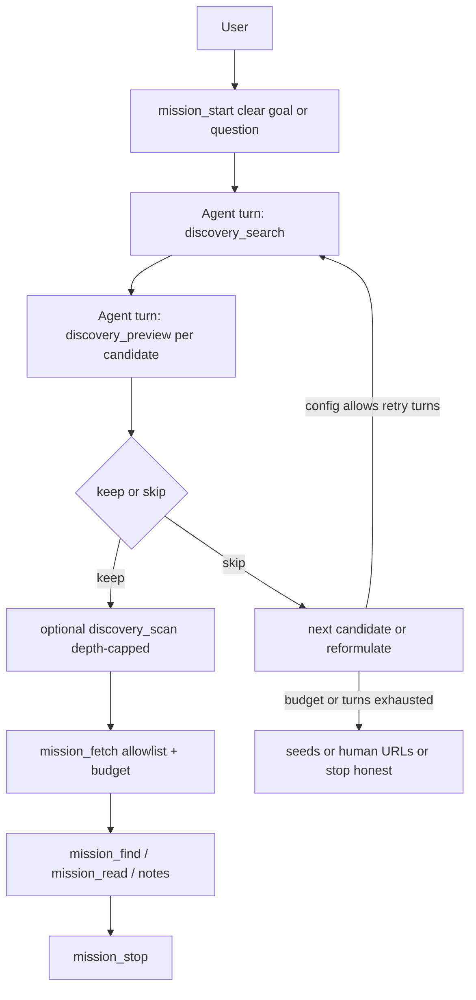
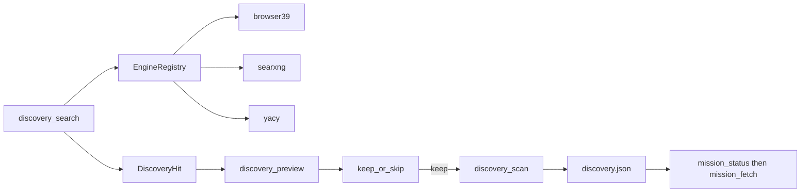

# P0.5 — Engine registry, tool verbs, depth cut

**Repo:** `~/dev/dsh-web-discovery`  
**Sibling:** `~/dev/dsh-web-missions`  
**Written:** 2026-10-16 ~00:35  
**Audience:** agent sessions in this checkout — prefer this markdown over Cursor Plan UI.

Sacred ports: never kill **`:3080` / `:8080`**. Acceptance web: **`:3090`** only.  
Agents: **commit OK; never push / never npm publish** unless operator says so.

### STOP — architecture undecided (Fable 5)

**Do not implement preview/scan/categorizer until**  
[`FABLE-5-discovery-loop.md`](./FABLE-5-discovery-loop.md) is rubberducked with an expensive model.

Big law under debate:

> Discovery is **not** a parallel sidecar. It rides the **same agent turn loop** as missions: **one tool call at a time, sequential.**

Also undecided: time/step/token budget; snippet aggregate vs **1–2B local categorizer** vs honest **subagent**. That doc is the handover for the good-token account.

---

## Snapshot (where we are)

| Claim | Reality |
| --- | --- |
| P0 packaging | **Done.** `dsh-build-tools`, strict prepare, name `dsh-web-discovery`. |
| GitHub | **Yes.** `janpauldahlke/dsh-web-discovery`, `main` clean. |
| npm | **`dsh-web-discovery@1.0.0` latest** (also still has `0.0.0-stage` in version list). |
| Live dogfood | **No.** Profile still has `dsh-local-web-discovery` symlink; `:3090` often down. |
| Engines today | SearXNG + browser39 (auto still SearXNG-first — flip in this board). |
| Hermetic | `npm test` 48 checks green last known. |

---

## Decisions (locked)

1. **Three engines minimum, all optional:** `browser39` → `searxng` → `yacy`.
2. **Default #1 = browser39** (flip auto order in `discovery-tool.ts` / `DISCOVERY_ENGINES`).
3. **SearXNG stays** — typed HTTP JSON → uniform `DiscoveryHit` (teaching pattern).
4. **YaCy** — `http://127.0.0.1:8090/yacysearch.json` (empty endpoint = absent → honest `no_engine`).
5. **npm 1.0.0 shipped.** Fold discovery into missions package later. Stay companion + one-way `discovery.json`.
6. **No DIY DDG scrape** (Eris scar). No cloud LLM in the search/preview loop.
7. **Discovery is a thin opener** — hard caps on steps, tokens, and wall time. Iterate toward the mission answer; do not run a second full research loop inside discovery.

---

## Speed, token tax, steps (think before build)

Discovery competes with the real work (`mission_fetch` → find → read → note → stop). Every discovery tool call is **one agent step** and its receipt sits in **context**. Unbounded preview/scan will feel slow and burn the run before the answer exists.

### Rough cost by verb

| Verb | Wall clock (order of magnitude) | Token tax | Step tax |
| --- | --- | --- | --- |
| `discovery_search` via **SearXNG / YaCy** | fast (local HTTP, ~0.1–2s) | low (titles + short snippets × N) | **1** |
| `discovery_search` via **browser39** (default) | slow (browser + SERP, often **5–30s+**) | low–med (same shape, maybe thinner snippets) | **1** |
| `discovery_preview` (browser fetch) | slow per URL (**seconds each**) | **high** if body returned fat | **1 per call** (or 1 if batched compact) |
| `discovery_scan` | slow × branching | med–high | **1+** and multiplies candidates |
| `mission_fetch` | slow, but **this is the paid research** | high (artifact) | 1 — spend here on keepers only |

So: default engine being browser39 means **even one search is already expensive**. That argues for **tight `limit`**, rare reformulate, and **almost never** previewing the full SERP list.

### Design bias — iterate to the answer

```
mission_start (clear question)
  → 1× discovery_search (limit small)
  → SERP-snippet triage (free — no fetch)   ← first keep/skip cut
  → preview ONLY top K survivors (K tiny)
  → 0–1× scan only if goal needs link hop
  → mission_fetch on 1–2 keepers
  → find / read / note → stop
```

Rules of thumb for v0:

1. **Snippet-first triage** — title/snippet from search is enough for most skips. Do not preview every hit.
2. **Small defaults** — search `limit` default **5** (not 10); `maxPreviewPerSearch` **2**; `maxSearchTurns` **1** (reformulate is opt-in via config, not the happy path).
3. **Scan is opt-in / off by default** — depth crawl is the token+time bomb; skill says “only if the keeper is a hub (docs index, TOC)”.
4. **Compact receipts** — preview returns `verdict + reasons + previewChars` (hundreds of chars, not pages). Never dump full HTML/markdown into the tool result.
5. **Batch preview in one tool call (optional)** — `discovery_preview({ urls: [...] })` with max K still **one step**, sequential fetches inside the tool, one compact table back. Cuts step tax without true parallelism in the agent loop.
6. **Wall-time budget (config)** — e.g. `maxDiscoveryMs` soft ceiling; tool returns `budget_exhausted` mid-list rather than hanging the turn.
7. **Skill copy** — “Discovery gets you candidates. The answer lives in mission notes after fetch. Prefer one tight search + two keepers over exploring.”

### Proposed knobs (supersedes looser table below)

| Knob | v0 default | Why |
| --- | --- | --- |
| `limit` (search default) | `5` | Fewer candidates → fewer temptations to preview |
| `maxSearchTurns` | `1` | One query; reformulate only if operator raises this |
| `maxPreviewPerSearch` | `2` | Snippet triage first; fetch-preview is scarce |
| `maxDepth` | `1` for scan default (or scan disabled until explicit) | Depth 2 fans out fast |
| `maxDiscoveredHosts` | `3` | Same as missions fence |
| `previewChars` | `~800–1500` | Enough to judge, not enough to “read the article” in-tool |
| `maxDiscoveryMs` | `45000`? | Soft cap per discovery tool invocation |

Happy path step count target: **≤ 4 discovery-related steps** before first `mission_fetch` (start → search → preview-batch → fetch).

---

## Overall flow (mission owns the loop)

> ### BIG DESIGN LAW (v0 assumption — confirm in Fable 5)
>
> **Discovery is not a parallel sidecar process.**  
> It rides the **same agent turn loop** as missions: **one tool call at a time, sequential.**  
> No background worker, no nested researcher, no hidden second model — unless Fable explicitly upgrades us to subagent territory.

See [`FABLE-5-discovery-loop.md`](./FABLE-5-discovery-loop.md) for time budget, aggregating links, and 1–2B categorizer vs subagent.



### Sequencing rules

| Rule | Meaning |
| --- | --- |
| Mission first | `mission_start` before discovery. Need a **clear question / goal** (same discipline as missions Goal section). Bad query in → junk SERP out. |
| Sequential turns | Discovery verbs are normal tool calls. **Not parallel** with each other or with `mission_fetch`. One verb → observe → next. |
| Discovery does not own the agent | No nested agent. Preview/scan return structured receipts; the **outer** agent decides keep / reformulate / fetch. |
| Reformulate path | If keep-rate is trash, agent may refine the query and call `discovery_search` again — **bounded by config** (see below). |
| Missions still gates egress | Candidates in `discovery.json` are not ledger rows. `mission_fetch` applies allowlist + budget + depth fence. |

### Config: discovery budget

See **Speed, token tax, steps** above for defaults. Operator may raise `maxSearchTurns` / `maxPreviewPerSearch` for hard queries; happy path stays one-shot + tiny preview.

Skill copy: **do not burn the run on discovery.** Search is an opener; the final result is mission notes after fetch.

---

## Keep / skip metrics (deterministic — no LLM judge)

Preview returns a **verdict + reasons**, not a vibes score. Agent (or optional auto-drop of hard skips) uses this.

### Hard skip (engine / transport)

| Signal | Meaning |
| --- | --- |
| `blocked` / bot challenge | Same scar as `browser39_blocked` — not a 0-hit success. |
| Non-2xx / empty body | Nothing to read. |
| `thin` / `js_shell` / `low_density` | Align with missions `page_quality` vocabulary where possible. |

### Soft skip (heuristic demote — still show to agent)

| Signal | Meaning |
| --- | --- |
| Login / paywall cues | Title/snippet/URL patterns (`login`, `signin`, `subscribe`, …). |
| Junk / aggregator hosts | Optional operator host denylist in config (not an endless hardcoded list). |
| Duplicate host | Already kept another URL on same host this search turn. |
| Off-goal lexical miss | Query tokens absent from title+snippet+preview window (crude but honest). |

### Keep

| Signal | Meaning |
| --- | --- |
| `ok` + primary-ish | http(s), readable preview, query tokens present, not hard-skipped. |
| Official / docs host prior | Optional operator **allow-priors** (boost, not exclusive). |

Receipt shape (sketch):

```
discovery_preview → {
  ok: true,
  url,
  verdict: "keep" | "skip",
  reasons: ["thin" | "blocked" | "login_wall" | "dup_host" | "token_miss" | …],
  preview?: string,   // truncated
  title?: string
}
```

**No cloud LLM “is this worth it?”** — if we want smarter later, that is a separate board and stays optional.

---

## Tool verb cut

| Verb | Does | Does not |
| --- | --- | --- |
| `discovery_search` | SERP → `{url,title?,snippet?}`; optional `mission_id` → `discovery.json` | Page fetch, ranking beyond engine auto-order |
| `discovery_preview` | Light fetch + deterministic keep/skip receipt | Ledger row, deep crawl |
| `discovery_scan` | From kept URL(s), follow links within depth/host fence → more candidates in `discovery.json` | `mission_fetch`; allowlist still at fetch time |

Uniform engine contract: `DiscoveryHit` / `DiscoveryEngine` in `src/host/discovery-port.ts`. Each engine file: raw API types → mapper → hits.



---

## Implementation checklist

### A — Registry + YaCy + browser39-first

- [ ] Widen `DiscoveryEngineKind`; reorder `DISCOVERY_ENGINES` to browser39, searxng, yacy.
- [ ] Add `src/host/engines/yacy.ts` + `yacyEndpoint` / `YACY_ENDPOINT`.
- [ ] Refactor `config.ts` / `tools.ts` so engine N = register + config field.
- [ ] Smoke: stub YaCy; auto order; pinned engines; absent = `no_engine`.

### B — Depth + preview/scan verbs

- [ ] Config: `maxDepth`, `maxDiscoveredHosts`, `previewChars`, `maxSearchTurns`, `maxPreviewPerSearch`.
- [ ] Implement keep/skip classifier + receipts.
- [ ] `discovery_preview` / `discovery_scan` tools; browser39 fetch path for preview/scan body.
- [ ] Smoke fixtures for keep/skip + depth cap.

### C — Live wire + skill press

- [ ] Profile: `~/.dsh/profiles/web/node_modules/dsh-web-discovery` → this checkout (drop stale `dsh-local-*` link).
- [ ] Boot `:3090` only. AC: three verbs; health `discovery: on`; `discovery.json` on `mission_status`.
- [ ] Update missions `skills/web-mission-workflow/SKILL.md`: mission_start → search → preview → optional scan → fetch; browser39-default; turn budgets; never invent SERP URLs.

### D — Deferred

- [ ] dsh.pub submit (npm `1.0.0` already up).
- [ ] Fold package into missions.
- [ ] Cloud LLM ranking / DIY DDG scrape / sidebar UI.
- [ ] Deprecate/unpublish npm `0.0.0-stage` if desired.

---

## Success

- Three engines registerable; auto = browser39 → searxng → yacy; any subset missing still honest.
- Agent loop is **mission-first, sequential, tightly capped** — snippet triage → few previews → fetch keepers → answer.
- Live `:3090` → `discovery: on` + recorded candidates.
- `npm test` hermetic green.

---

## Open questions (operator)

1. **Auto-drop hard skips?** Or always return skip to the agent and let it choose?
2. **Does `discovery_scan` cost missions fetch budget** or only discovery turn counters?
3. **`maxSearchTurns` default `1`** (locked bias above) — raise only via config?
4. **Batch preview** (`urls[]` in one call) — yes for v0 to cut step tax?
5. **Default engine tension:** browser39-default is slow; should auto prefer SearXNG when reachable, and keep browser39 as pin/fallback? (Product vs latency.)
6. **FABLE 5 (blocking):** same-loop law vs 1–2B local categorizer vs subagent — how much time/steps/tokens can discovery afford? → [`FABLE-5-discovery-loop.md`](./FABLE-5-discovery-loop.md)

Bias for v0 (pending Fable): return all verdicts to the agent (no silent drop); scan does **not** spend mission fetch budget; `maxSearchTurns: 1`; batch preview yes; **revisit #5–#6 with expensive model**.
